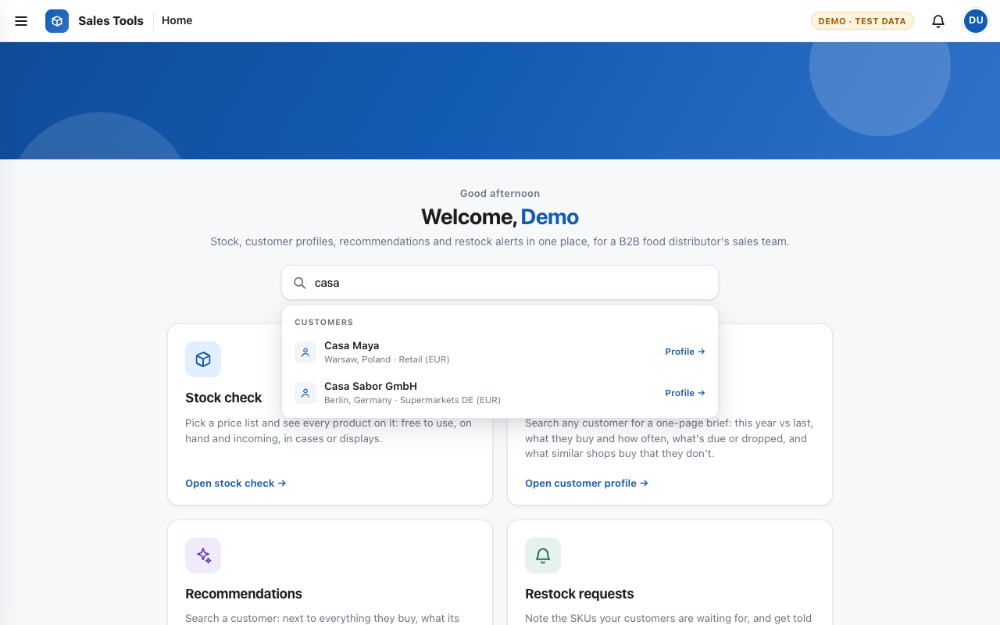
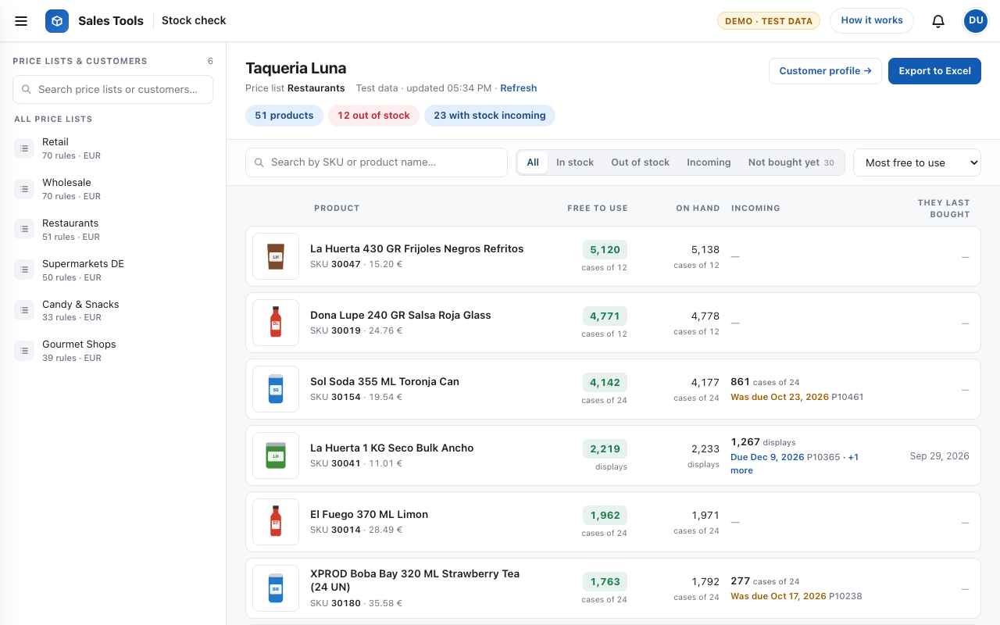
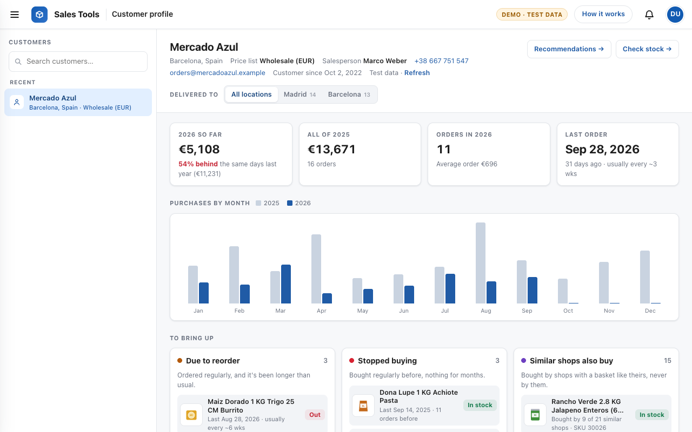
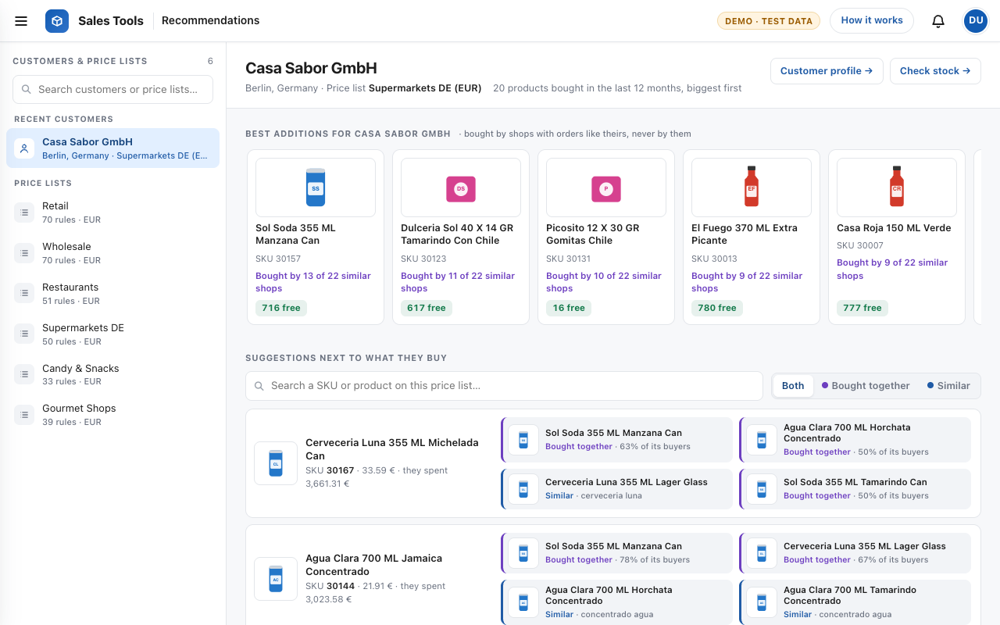
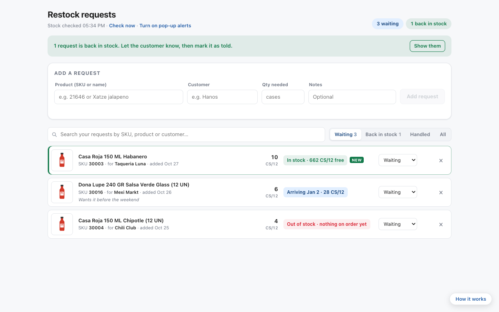

# Sales Tools

Internal web tools for a B2B food distributor's sales team: **live stock per price
list**, a **one-page brief on any customer**, **product recommendations**, and
**restock alerts**, in one fast, no-install web app.

**[▶ Open the live demo](https://sofiasanjose.github.io/sales-tools/)**: it runs on
generated test data, so click around freely.



> I built this during my internship at Crevel Europe, a European distributor of
> Mexican and American food, for its sales team. **This public
> version contains no company code or data:** every shop, product, order and stock
> figure is made up by [`tools/build_demo_data.py`](tools/build_demo_data.py), and
> the ERP connection is replaced by a small adapter that serves that data.

---

## The tools

### Stock check
Pick a price list, or type a customer's name to open theirs, and see every product
on it with **free to use** (on hand minus what's reserved for other orders), **on
hand**, **incoming** deliveries with their due dates (late ones flagged), and when the
client last bought it. Quantities are shown in the case or display each product is
sold in; hover for single units. Opened for a customer, **Not bought yet** lists
what's on their price list that they've never ordered.



### Customer profile
A brief to read before a visit or a call: this year against the **same days last
year**, purchases by month, how often they order (and whether they're **overdue**),
then what to bring up:
- **Due to reorder:** products they buy regularly where it's been 30% longer than their usual gap.
- **Stopped buying:** regulars with nothing for over 4 months and three usual gaps.
- **Similar shops also buy:** what the 25 customers with the most similar basket buy and they don't.

Customers with several shops get a **Delivered to** switch (by delivery province/city;
one-off home deliveries are grouped as "Other places"), and the whole page follows it.



### Recommendations
Search a customer: next to every product they buy, **bought together** suggestions
(what the product's other buyers also buy) and **similar** products, never something
they already buy, another size of it, or a sample. On top, the **best additions** from
shops with orders like theirs. Also works for a whole price list.



### Restock requests
Salespeople note the SKUs a customer is waiting for; the app re-checks stock
regularly and flags requests as soon as stock is free (badge, banner, optional
browser notifications).



---

## How the recommendations work

All of it runs on 12 months of orders from every customer.

| Signal | How it's computed |
|---|---|
| **Bought together** | For product A, the share of A's buyers who also buy B (*confidence*). Kept only when *lift* = confidence ÷ B's overall popularity is above 1, so best-sellers don't win just for being popular. |
| **Similar** | Product names are split into telling words (brand, type, flavour), each weighted by IDF so rare words count more. Candidates need a match score ≥ 0.25 and, for longer names, at least two shared words. A bonus goes to the same category and to popular products. |
| **Similar shops** | Customers ranked by Jaccard similarity of their baskets (at least 3 products in common). Products the 25 nearest buy are scored by summed similarity. |
| **Never suggest** | Anything already bought or on the list, samples, and "another size of the same thing" (same set of name words). |

## Architecture

```
Real tool                                        This demo
─────────                                        ─────────
Browser (HTML + vanilla JS, one shared           Same pages
  stylesheet, tools in iframes that link
  to each other)
      │ fetch /api/...                               │ fetch /api/...
      ▼                                              ▼
Python API (Azure Functions; Flask locally)      assets/demo-api.js answers from
      │ XML-RPC                                    demo-data/*.json (built by
      ▼                                            tools/build_demo_data.py)
Odoo ERP: stock, orders, price lists
```

- **No build step, no frameworks:** plain HTML, CSS and JavaScript, so it loads instantly and anyone can maintain it.
- **Fast on big data:** price lists with 5,800+ products are read in chunks of 200 with five parallel ERP connections, with retries for a busy server. That cut one stock check from 59 s to 17 s. Results are cached for 5 minutes, and the year of order history behind recommendations for 30 minutes.
- **Made for Azure Static Web Apps** behind the company's Microsoft sign-in, with the ERP key kept only in the host's environment variables; it also runs as a local Flask app.
- **Readable everywhere:** product names are cleaned from ERP codes (`[30003] SALPIC CASA ROJA 150 ML HABANERO` → *Casa Roja 150 ML Habanero*), with a light/dark theme and a phone layout.

## Run it locally

```bash
python3 -m http.server 8000      # then open http://localhost:8000
```

To regenerate the test data (dates move with today's date):

```bash
python3 tools/build_demo_data.py
```

## Built with

HTML · CSS · JavaScript · Python · Odoo XML-RPC · Azure Static Web Apps & Functions · Flask
